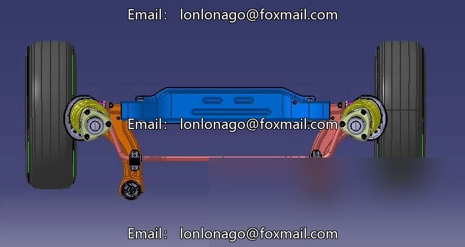
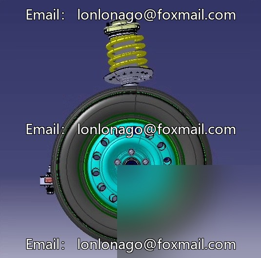
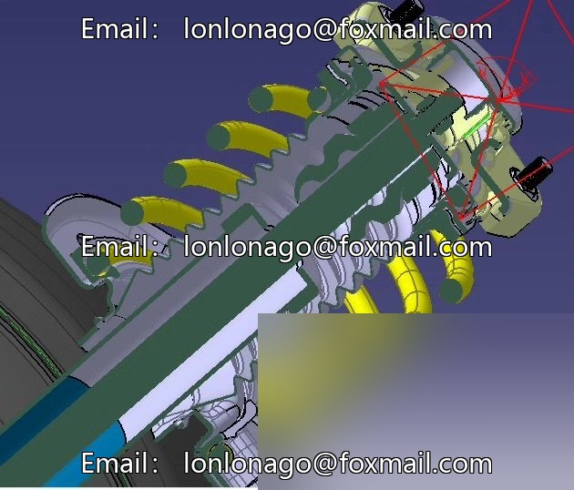
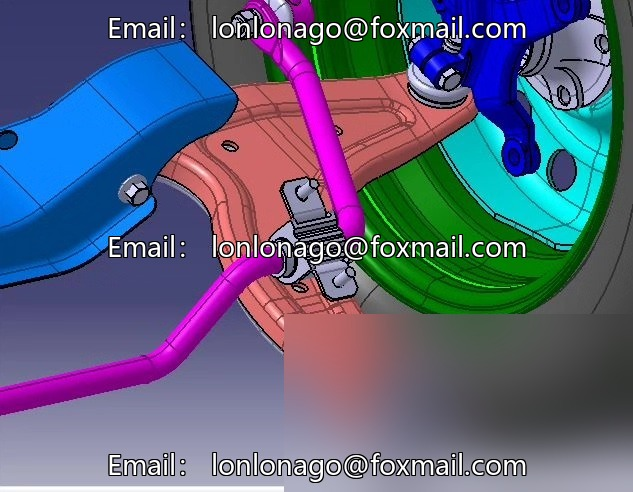

# McFoy suspension design, McFoy suspension diagram, McFoy suspension 3D diagram, McFoy suspension design.

## Body

MifoSS suspension design MifoSS suspension diagram MifoSS suspension three-dimensional diagram MifoSS suspension design diagram MifoSS suspension numerical model MifoSS suspension 3D MifoSS suspension data model
Multiple models, can be opened and edited with Catia UG, SolidWorks, and other software
A042 There are other various 3D drawings as well, including modeling and numerical model modification services, with specific details to be discussed further

Mafson suspension design covers design drawings, 3D figures, model and 3D models; modeling and model modification services are available, with CATIA UG SolidWorks and similar tools for opening and editing.

<!-- AI_ENRICHED -->

## Images

## Payment

Here is a pay link on Stripe ( https://buy.stripe.com/3cs8yP7sY87d0vu9AB ). Please contact me lonlonago@foxmail.com after funding $89, and I will send you a complete data files , thank you!

